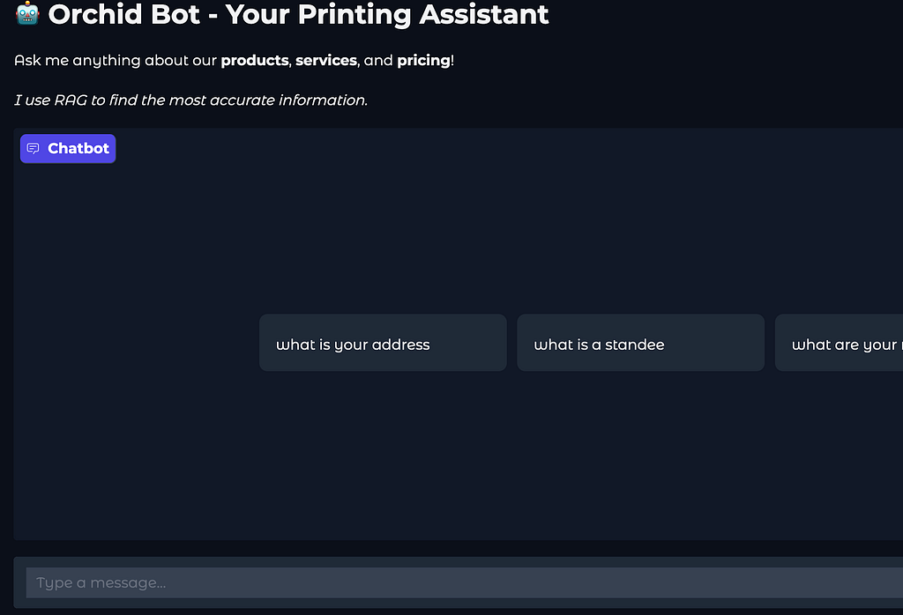
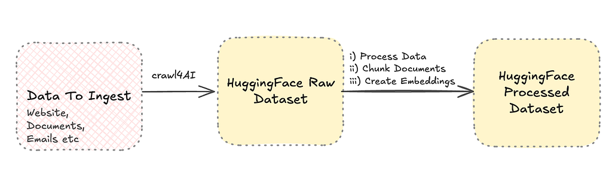
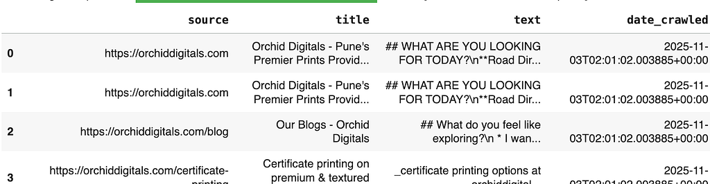
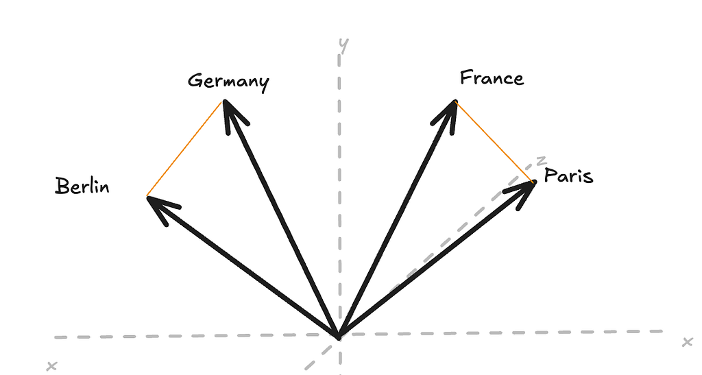
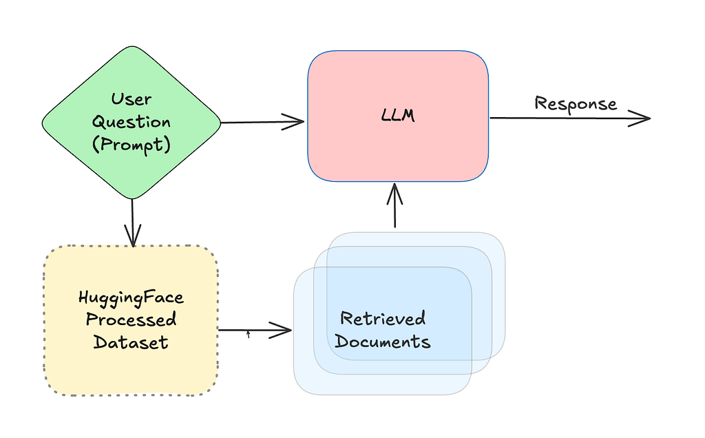

Let’s build a working custom chatbot for a small business. Orchid Enterprises is a print shop in India. They get a large volume of phone calls asking similar questions, and many of the answers already live on their [website](https://orchiddigitals.com/). Let’s make those answers easier for customers to find.

In this article, I’ll explain RAG and semantic search, and how they work together to build a domain-specific assistant.

## Let’s Demo!

We have a working demo available in [HuggingFace](https://huggingface.co/spaces/sagsan/orchid-chatbot) (HF). There are also [Colab notebooks](https://drive.google.com/drive/folders/1DHiTyJQYM4FXrXPXLUGF6_GSqkZAQxhI?usp=sharing) available for all the stages to build this if you want to peek under the hood.



*Custom RAG enabled chatbot for a small business*

Below we will go through how this works and we will dive into code in future articles.

## So what is RAG?

RAG—retrieval-augmented generation—follows in the grand tradition of AI researchers giving straightforward ideas complicated names. It gives a language model relevant information at question time. Instead of retraining the model, the system retrieves useful passages and includes them as context in the prompt.

Retrieval can come from tools such as web search, or from a controlled collection of documents. For this project, we query a document store built from the business’s website, so we control the source material supplied to the model.

This approach can be cheaper and faster than open-ended web retrieval. It can also keep sensitive source material within a controlled system—for example, an internal assistant built on a law firm’s private documents.

### RAG Pipeline — Data Processing

RAG is a multi-step process, so it helps to think of it as a pipeline. Our first task is to collect and process data so the retriever can use it. The steps are shown below.



*Data Ingest and Processing Steps for RAG*

**Step I — Website crawling:** First, we use Crawl4AI to scan the business’s existing website. The raw data is uploaded to a Hugging Face dataset so we do not need to repeat the slower crawl step each time.



*RAW Data*

**Step II — Chunking and encoding:** Next, we prepare the page content for retrieval. We perform two operations on the text: *chunking* splits it into smaller pieces, and *embedding* converts each chunk into a vector of numbers.

### Side Bar on Embeddings

Embedding converts our chunked text into numbers. An embedding is a vector learned by a machine-learning model to represent semantic properties of text. To build an intuition for this, consider the graph below.



*The difference between France and Paris is similar to the difference in Berlin and Germany*

An embedding is a list of numbers, so we can visualize it as a point in space. In this simplified example, related concepts such as France–Paris and Germany–Berlin have similar relationships. Real embedding spaces have many more dimensions, but the intuition is the same: similar meanings tend to be located near one another.

Sidebar over—let’s get back to the RAG project.

The embeddings capture semantic information from the documents. When a user searches for *“big banner for outside,”* the retriever can match a passage such as *“durable outdoor vinyl signage”* even though the words are not identical. Finally, we save the generated embeddings to another Hugging Face dataset for use by the chatbot.

### RAG Pipeline — Chatbot

Once our dataset is saved as embeddings in our HF Dataset, the rest of the project becomes a prompting exercise.



*LLM uses the documents matched by Semantic Search to Respond*

1. The user’s question is used to *retrieve* matching documents from the dataset.
2. The LLM receives both the question and retrieved documents as context, then *generates* a response.

The prompt instructs the LLM to answer from the retrieved documents and say when the context does not contain an answer. This reduces hallucinations, though prompt instructions alone cannot eliminate them.

```text
    "You are an accurate, helpful RAG assistant for a printshop called Orchid Enterprises whose CEO's name is Mitesh Sanghani"
    "If the answer is not contained within the context, state 'I do not know the answer.'
```

## Conclusion

This was a weekend project. In the next part of the series, we’ll walk through the [crawler code](https://colab.research.google.com/drive/1rwjVCvog0BC97mVqQJ4q27T3kOnryOsX#scrollTo=m1Dw2MmPSomw) in detail.
