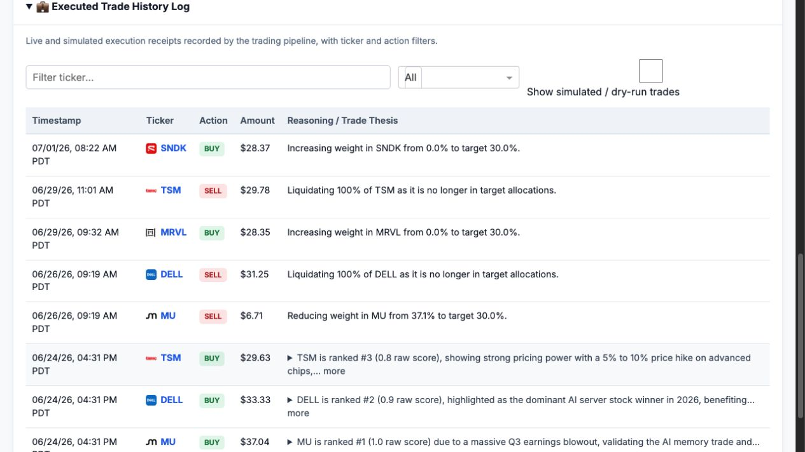

I built an agent-based stock trader for the [Kaggle five-day agents course](https://www.kaggle.com/learn-guide/5-day-agents), connected it to Robinhood, and gave it roughly $100. By July 20, 2026, the account was worth $71.94, a loss of about 28%.

The system could gather data, analyze news, propose allocations, execute orders, and publish its records. That established an end-to-end workflow, but it did not establish a profitable strategy. The most useful engineering lesson was deciding which decisions to leave to agents and which rules to enforce in Python.

*This is a personal engineering experiment, not investment advice. I stopped live orders in mid-August 2026; the dashboard remains online.*

> **Watch the recorded demo:** [Autonomous Stock Trader walkthrough](https://www.youtube.com/watch?v=kQS5lmFw7Vs). The recording shows an earlier dashboard snapshot, not the July 20 results discussed below.



The first time my stock-trading agent placed a live order, I got two notifications. One came from the application through Discord. The other came from Robinhood.

I had first run the system in shadow mode for two weeks without allowing it to place real orders. I checked performance daily. The results were poor: the system kept proposing trades on every run, so I added a hard 21-day minimum holding period to reduce turnover. Seeing an order land in the brokerage account was still a milestone. The project had crossed the line between producing an answer and actually doing something.

## I built it one small piece at a time

The first end-to-end version took a weekend to wire up. Testing, debugging, and stabilizing it took another week or two.

I wrote very little of the code myself. Antigravity and Codex produced most of the implementation. My work was closer to product development: define the architecture, break the product into features, inspect the behavior, and tighten the requirements when reality disagreed with the plan.

I did not ask an agent to “build me a stock trader.” First, I asked it to connect to Robinhood. Then to write and query BigQuery tables. Market-data ingestion came next, followed by sentiment analysis, portfolio decisions, execution, and the dashboard. Even the Streamlit visualizations were built and checked separately before I brought them together.

There were a lot of moving pieces. The code came together quickly; figuring out whether the full system was safe and coherent took much longer.

The pipeline separates analysis from execution:

| Stage | Responsibility |
| --- | --- |
| Market data and screening | Python filters price and technical data before any language-model calls. |
| News analysis | Gemini scores recent news; the pipeline smooths scores over several days. |
| Portfolio review | An analyst proposes allocations and a risk advisor reviews them in an ADK loop. |
| Execution | Deterministic Python checks the proposal and calculates orders, using the Robinhood MCP integration. |
| Records and dashboard | BigQuery stores metrics, decisions, trades, and snapshots; a separate frontend displays them. |

Google's Agent Development Kit (ADK) coordinates the agent loop. Model Context Protocol (MCP) exposes broker operations through a tool interface. Neither framework makes a recommendation financially sound; the execution checks still have to live in code.

## The financial strategy, in plain English

The trader focuses on volatile companies connected to AI infrastructure. The implementation reviewed here has an allowlist of 42 symbols: semiconductor companies, cloud platforms, data-center suppliers, power companies, software and security firms, plus one defensive Treasury ETF. That concentrates the experiment in one investment theme.

Each run starts with cheap, deterministic screening. Python narrows the 42-symbol universe to an 11-stock watchlist using price history. Anything already owned stays on the list. Other stocks generally need to trade above their 50-day average, although a deeply oversold company can qualify as a possible value opportunity. This stage uses no language-model tokens.

Gemini then reads recent news for the shortlist and scores the tone from -1 to +1. The pipeline blends that result into a five-day weighted average, so a single headline has less influence than it would in an unsmoothed score. This is an exponentially weighted moving average: recent observations receive more weight. Smoothing does not validate the score or show that it predicts returns.

The system looks for two kinds of entry. A “dip” candidate is at least 10% below its one-year high but still has positive, reasonably stable news sentiment. A “breakout” candidate is reaching a recent high while its price momentum turns upward. These are mechanical entry conditions, not evidence that a company is undervalued or will keep rising.

The portfolio can hold no more than three positions, usually targeting about 30% in each and leaving the rest in cash. The 21-day minimum hold came from that shadow-testing experience: the early recommendations changed far too often. The number was a hypothesis based on watching stocks such as Micron: daily prices could be chaotic, while the trend over two or three weeks had often been more consistent during the previous six months. I did not measure a controlled before-and-after improvement from this rule. The original design allowed an exception for severely negative sentiment, so the hold was not an unconditional ban on selling.

## AI recommends; Python decides

One Gemini agent acts as a portfolio analyst and proposes target allocations. A second acts as a senior risk advisor. It checks the proposal and can send it back for revision, up to five rounds.

I added the second agent because the first one kept changing its mind between runs. The debate added a review step, but it did not establish that the recommendations were stable or correct. A second language model can misunderstand a rule just as easily as the first.

The current system therefore treats the agents’ output as a recommendation. A deterministic Python policy independently checks the account, ticker allowlist, prices, cash, position limits, holding rules, and final approval before an order can reach Robinhood. The broker operation itself is also handled by regular Python rather than free-form agent behavior.

The executor also checks settled cash rather than assuming that proceeds from a sale are immediately available. These controls constrain what can execute; they do not eliminate all software failures or losses. Moving authorization into code ended up being the most important design decision in the project.

## The live results are not good

BigQuery records eight live orders between June 24 and July 1. The first portfolio bought MU, DELL, and TSM. Later runs reduced MU, sold DELL and TSM, and bought MRVL and SNDK. By July 20, the account held MU, MRVL, and SNDK. These early records include sales within a week of purchase; they should not be taken as evidence that the later holding-policy implementation was enforced throughout the experiment.

*Dashboard captured on October 25, 2026, with simulated trades excluded. These are historical execution records, not evidence of the July 20 account valuation.*

My July 20 account figures were $71.94 in total equity, including $11.01 in cash, with $25.74 of unrealized losses. Three ticker symbols did not provide much diversification when all three were versions of the same concentrated AI bet.

These July 20 figures are my confirmed historical records; a retained July dashboard snapshot is not included here for independent reconciliation. Unrealized loss covers open positions and is not the same measure as the change in total account equity.

My [original Kaggle write-up, dated July 6](https://www.kaggle.com/competitions/vibecoding-agents-capstone-project/writeups/new-writeup-1783318790626), reported a 13.1% loss at that earlier point. The recorded demo also shows an earlier balance. Those figures should not be read as the July 20 result.

A few weeks, three current positions, and a tiny account cannot establish investment performance or isolate the effect of any individual rule. The portfolio's concentration was a clear limitation, but this experiment does not tell me how much of the loss came from stock selection, timing, turnover, or the sentiment model.

## The dashboard makes the experiment inspectable

Every run writes market metrics, recommendations, portfolio snapshots, and trade history to BigQuery. The original frontend used Streamlit to turn those records into the public [portfolio dashboard](https://portfolio-dashboard-412197301452.us-central1.run.app).

The dashboard shows more than completed trades. It shows which stocks the system analyzed, the technical and sentiment measures behind its recommendations, the current portfolio, and performance against the S&P 500. Because it reads from BigQuery, it also remains separate from Robinhood authentication and does not need a live brokerage session every time somebody opens the page.

You can explore the [live dashboard](https://portfolio-dashboard-412197301452.us-central1.run.app) or read the [source code on GitHub](https://github.com/sagar-san/stock-trader).

## What I would do before adding more money

I stopped live orders in mid-August 2026 because I did not have time to monitor them. The [public dashboard](https://portfolio-dashboard-412197301452.us-central1.run.app) has remained online. The July figures above describe the historical experiment; the dashboard may show a different, later snapshot.

The larger gap is backtesting. The full pipeline needs to be replayed against historical data without giving it access to future information, while tracking a realistic simulated account and trading costs. The sentiment layer needs its own evaluation too. Gemini produces a score, but I have not yet proved that the score is consistent or useful.

Before restarting live orders, I would want evidence for the strategy as well as tests of the execution controls. Finishing the application was much easier than demonstrating that its decisions deserved more money.
