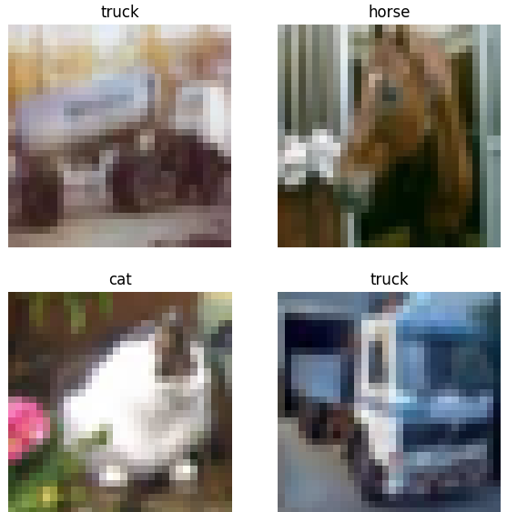
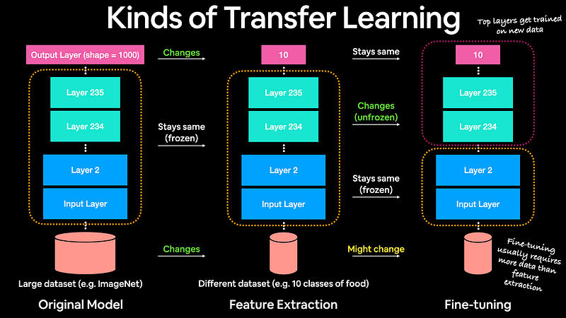
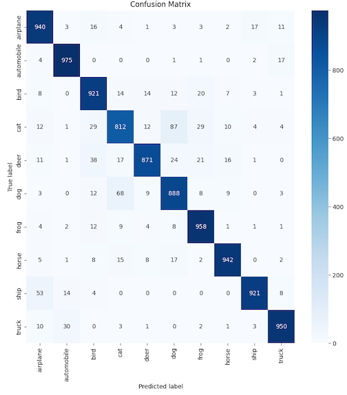

<!-- EDITORIAL NOTES

Before publication, confirm which evaluation produced the reported 91.1% test accuracy. The supplied 10,000-example confusion matrix contains 9,178 correct predictions (91.78%), so it appears to come from a different checkpoint or evaluation pass.

END EDITORIAL NOTES -->

I wanted to know whether a compact pretrained vision model could clear 90% accuracy on CIFAR-10 without training a network from scratch. I adapted MobileNetV2 in two phases: first training a new classification head while keeping the pretrained backbone frozen, then fine-tuning part of that backbone with a smaller learning rate.

The final model reached a reported **91.1% test accuracy**, with training accuracy around **93%**. The result showed that transfer learning could adapt a relatively small model to low-resolution images, but the error analysis also exposed a persistent weakness: cats were often classified as dogs.

This is Part 1 of the experiment. [Part 2 compares this hand-built model with Vertex AI AutoML]().

## Experiment snapshot

- **Question:** Can MobileNetV2 exceed 90% accuracy on CIFAR-10 through transfer learning?
- **Dataset:** CIFAR-10, with 60,000 32×32 color images across ten classes.
- **Approach:** Train a new ten-class output head, then fine-tune the later MobileNetV2 layers.
- **Reported result:** 91.1% test accuracy, compared with roughly 93% training accuracy.
- **Artifact:** [Open the manual-model notebook in Google Colab](https://colab.research.google.com/drive/1C4VTYyMjUNAcOYHCZA_U-xdy1N40rQXi?usp=sharing).
- **Main limitation:** The experiment used a single model run and did not systematically compare fine-tuning boundaries, augmentation strategies, or alternative architectures.

## Why transfer learning

Deep-learning models can require substantial data and compute when trained from scratch. Transfer learning starts from a model that has already learned useful visual features on a larger dataset and adapts those features to a new task.

MobileNetV2 was a practical starting point because it was designed to balance image-classification accuracy with a small computational footprint. Its ImageNet-trained backbone already recognized general patterns such as edges, textures, and shapes. My task was to replace its original classifier with one that could distinguish CIFAR-10's ten categories: airplane, automobile, bird, cat, deer, dog, frog, horse, ship, and truck.



The 32×32 source images are challenging even for a person. In the sample above, the cat is not immediately obvious. That low resolution shaped the two-stage training strategy.

## Phase 1: Train the classification head

I first removed MobileNetV2's original ImageNet classification layer, froze the pretrained backbone, and added a ten-neuron softmax layer. Freezing the backbone meant that training changed only the new task-specific head.

```python
base_model = tf.keras.applications.MobileNetV2(
    include_top=False,
    input_shape=(32, 32, 3),
    name="warmup_checkpoint",
    weights="imagenet",
)
base_model.trainable = False

model = tf.keras.Sequential([
    tf.keras.layers.Input(shape=(32, 32, 3)),
    # Preprocessing steps omitted for brevity.
    base_model,
    tf.keras.layers.GlobalAveragePooling2D(),
    tf.keras.layers.Dense(10, activation="softmax"),
])

model.compile(...)
model.fit(...)
model.save("warmup_checkpoint.keras")
```

This first phase reached roughly **82% validation accuracy**. More importantly, it created a checkpoint with a trained CIFAR-10 head that I could refine without immediately disturbing the pretrained features.

## Phase 2: Fine-tune the backbone

Feature extraction leaves the backbone untouched. Fine-tuning allows some of its weights to change so the later features can better represent the new dataset.

The boundary matters. Unfreezing too much of the network can overwrite useful pretrained representations, a failure mode called **catastrophic forgetting**. Keeping every layer frozen, however, limits the model's ability to adjust to CIFAR-10's unusually small and blurry images.



*Diagram adapted from [Daniel Bourke's transfer-learning material](https://dev.mrdbourke.com/).*

For this run, I loaded the warm-up checkpoint, made the MobileNetV2 backbone trainable, then kept the layers before index 110 frozen. That left the later portion of the roughly 154-layer backbone available for fine-tuning. I also reduced the learning rate so each update would make a relatively small change to the pretrained weights.

```python
model_finetuned = tf.keras.models.load_model(
    "warmup_checkpoint.keras"
)

layer_container = model_finetuned.get_layer("warmup_checkpoint")
layer_container.trainable = True

for layer in layer_container.layers[:110]:
    layer.trainable = False

model_finetuned.compile(
    loss="sparse_categorical_crossentropy",
    optimizer=tf.keras.optimizers.Adam(learning_rate=...),
    metrics=["accuracy"],
)

hist_fine = model_finetuned.fit(...)
```

This distinction is easy to miss: the implementation did not fine-tune only five or ten layers. Freezing through layer 110 left roughly 44 MobileNetV2 layers trainable, although some of those layers may not contain learned parameters.

## Evaluate the errors

The aggregate score met the original goal, but the confusion matrix made the remaining failure modes more useful to inspect.



Cats were the weakest class in this evaluation. Of the 1,000 cat images represented in the matrix, 812 were classified correctly and 87 were labeled as dogs. The reverse confusion was also visible: 68 dog images were labeled as cats.

The supplied matrix contains 9,178 correct predictions out of 10,000, or 91.78% accuracy. Because that differs from the reported final test accuracy of 91.1%, the figure likely came from a different checkpoint or evaluation pass. The class-level pattern is still clear, but the two aggregate numbers should not be treated as the same run until that is confirmed.

Data augmentation or a different fine-tuning boundary could improve the cat-versus-dog errors. A stronger follow-up would test those changes across multiple seeds and compare the results against a smaller convolutional baseline.

## What this established

The feature-extraction phase reached roughly 82% validation accuracy; after fine-tuning, the model reached a reported 91.1% test accuracy. The roughly two-point gap between training and test accuracy did not indicate severe overfitting, but that gap alone is not enough to prove that the model generalizes broadly.

The more practical question is whether this result justified the engineering work. [Part 2 runs the same classification problem through Vertex AI AutoML and compares the outcome]().
