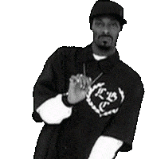
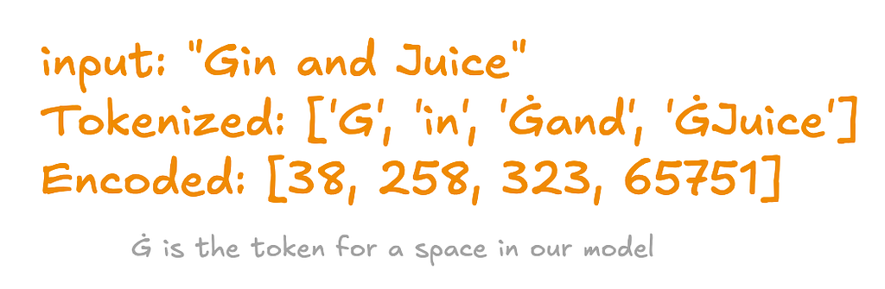
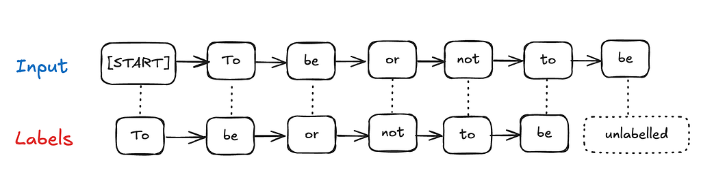
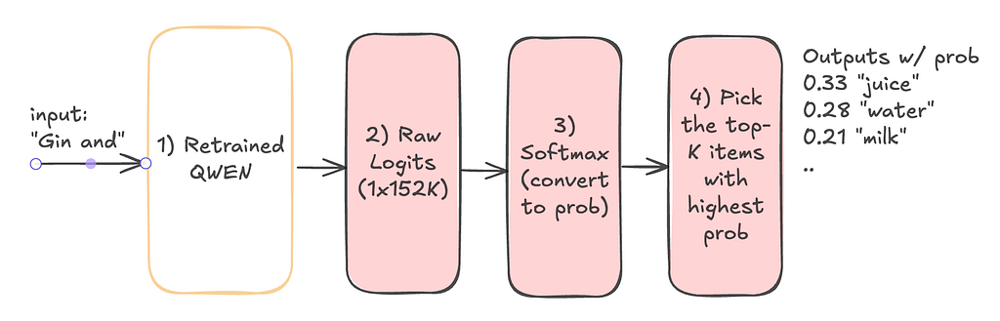

*The causal language model built on the works of Snoop and Shakespeare that no one asked for.*

Let’s learn about LLMs and fine-tuning while building an impractical language model. Our model is trained on the works of William Shakespeare and Snoop Dogg. We’ll work through merging contradictory styles and adapting a generic pretrained model to our custom dataset.

A causal language model (CLM) predicts the next token based only on the tokens that came before it. “*Causal*” means that the prediction uses the history, never future tokens.

## Demo



*I’m livin’ on edge, so jumped out of bed. Whose mother he did scorn for his father’s sake, How can’t love somebody else? Why should that be hard? Romeo. Nay then, go fetch the people from the streets; they are all gone*

Before we get to the details play with the working demo hosted on [HuggingFace](https://huggingface.co/spaces/sagsan/snoopshpear) (HF) — feel free to restart if it has shut-down. Almost all LLMs give us a bunch of levers to modify the output. To understand these params, the demo allows modifying the following params.

1. **Maximum output tokens:** How many total tokens to produce.

2. **Temperature:** Lower values are more predictable; higher values add variety but can become nonsensical.

3. **Top-K sampling:** Limit selection to the K most likely next tokens.

4. **Repetition penalty:** Higher values more strongly discourage repeated tokens.

Below, we’ll walk through how this works. For low-level details, see my [Colab notebook](https://colab.research.google.com/drive/1oQMaz0x2gacx7IGn1K-XfinyIME77wMH?usp=sharing).

## Building the Model

While this project is not practical, the ideas are quite extensible. You can imagine a similar model trained on legal and medical texts to analyze or even detect fraud in say medical lawsuits. Building these models follows a familiar set of steps:

1. Gather, clean, and process the training data—in our case, the works of Snoop and Shakespeare.
2. Tokenize the data so the model can process it.
3. Fine-tune and validate an existing general-purpose language model. I chose Alibaba’s [Qwen](https://huggingface.co/Qwen/Qwen2-0.5B-Instruct) because it was freely available and fit on my small GPU.

The rest of this article talks about this conceptually, [the notebook](https://colab.research.google.com/drive/1oQMaz0x2gacx7IGn1K-XfinyIME77wMH#scrollTo=gBnfPGtnIjVi) has the low-level details if you want to play with it.

## Data Processing

Both Snoop and Shakespeare have publicly available texts. I did much of the cleanup by hand using regular expressions in VS Code. I also cleaned up profanity—boy, Snoop swears a lot—and uploaded the [data to Hugging Face](https://huggingface.co/datasets/sagsan/snoopshpear/viewer/default/train?p=1&views%5B%5D=train&row=175). If you scroll through it, you’ll probably see more cleanup opportunities, such as empty lines and one-word sentences, that could improve performance.

Shakespeare has a **lot** more published text than Snoop—about 10 times more in my data. In early runs, the model mostly ignored Snoop’s style, so I upsampled his lyrics by duplicating rows to make the two sources more balanced. I uploaded the result as a custom Hugging Face dataset, which makes it easy to download:

```python
from datasets import load_dataset, DatasetDict
raw_datasets = load_dataset("sagsan/snoopshpear")
```

Many of Snoop’s and Shakespeare’s lines lack punctuation or do not flow cleanly in the raw data. Initially, the model produced paragraphs that were hard to decipher. I wanted line-by-line lyrical output, so I added a newline and a special `NEWLINE_TOKEN` to each input string. This gives the model an explicit signal for line boundaries.

```python
NEWLINE_TOKEN = "<|im_end|>" #

def append_newline_token(example):
    example["text"] = example["text"].strip() + "\n" + NEWLINE_TOKEN
    return example

formatted_datasets = raw_datasets.map(append_newline_token)
```

## Tokenization

Tokenization is the process of breaking words or sub-words into chunks and then into numbers, practically this looks like:



*Tokenization in Action*

Every model has its own set of tokens. In our model, there is no word for “Gin”, so it gets broken down. However, there are words for “ and” and “juice”. The Ġ is how our model represents spaces. As mentioned before, we are using Qwen because it fits on a smaller GPU. HuggingFace provides libraries to easily tokenize text across models.

```python
MODEL_CHECKPOINT = "Qwen/Qwen2-0.5B-Instruct"
tokenizer = AutoTokenizer.from_pretrained(MODEL_CHECKPOINT)

def tokenize(examples):
  return tokenizer(examples["text"])

tokenized_datasets = raw_datasets.map(tokenize)
```

Let’s consider what our tokenized inputs look like:

```text
[[5188, 33, 11262, 16868, 13, 4162, 314, 534, 27517, 30],
[261, 11, 8011, 319, 13],
[33, 16696, 2751, 33363, 13, 3412, 326, 11, 314, 2911, 11, 543, 21289, 2788, 1793, 2029, 11]
```

Each list above represents a sentence. Training an LLM is GPU-intensive, so we group tokens into fixed-length blocks to use the hardware efficiently. Longer context windows consume much more memory because standard attention scales quadratically with sequence length.

Conceptually, we reshape the input into blocks like these:

```text
 [
[list of fixed-length tokens],
[list of fixed-length tokens],
[list of fixed-length tokens],
...]
```

The code that does this is available in *group_texts* in the [notebook](https://colab.research.google.com/drive/1oQMaz0x2gacx7IGn1K-XfinyIME77wMH#scrollTo=9rcaC_3eHnMg).

## How LLM Fine Tuning Works

Our goal is to fine-tune an existing LLM called Qwen. Machine-learning training generally needs a label and a loss function. A label is the target—for house-price prediction, it might be a historical sale price. In a causal language-modeling task, the target is the next token, so the input sequence also provides the labels after shifting by one position.



*For each input word, the next word is the label. The last word remains unlabelled.*

Let’s walk through what happens when an LLM such as Qwen predicts tokens:



*How the next token is picked*

1. First we send the string “Gin and” to our model. The model sends it through its layers and outputs logits.

2. Logits are raw numbers for *each* token. The vocabulary size of QWEN is 152K, so we get an array of size 152K.

3. A function called softmax converts those raw numbers into probabilities.

4. Finally we select the Top-K items and pick the token that matches our requirements. So we get back “juice”, “water”, “milk” etc.

This flow is called forward propagation. During training, the trainer compares the outputs with the labels and adjusts the model parameters to reduce the error. That part is called backpropagation.

## Training Step

You could drop down to PyTorch and implement these steps directly; I walk through that lower-level workflow in [another article](/writing/high-performance-image-classification/). Here, I use Hugging Face’s wrapper functions to save boilerplate. The training mostly [follows the Hugging Face documentation](https://huggingface.co/docs/transformers/en/training), so I won’t repeat it. Let’s focus on a few interesting training parameters—“hyperparameters,” because AI folks like to overcomplicate things.

```python
from transformers import TrainingArguments

# First setup your training Argument class
OUTPUT_DIR = "snoop-shpear-clm-v13"
training_args = TrainingArguments(
    per_device_train_batch_size=8,
    per_device_eval_batch_size=8,
    num_train_epochs=3,
    learning_rate=5e-5,
   #...
)
```

1. `per_device_train_batch_size` and `per_device_eval_batch_size` control how many sequences are processed at once. Larger batches can improve throughput if the GPU has enough memory.

2. `num_train_epochs` controls how many full passes the model makes through the data. Too few can underfit; too many can overfit, producing good training performance but poor results on unseen text.

3. `learning_rate` controls the size of parameter updates during backpropagation. If it is too large, the loss may fail to converge. As with many things in ML, the right value is something you test against your data.

Our custom model is then trained and [uploaded to HF](https://huggingface.co/sagsan/snoopshpear) so it can be used anywhere.

### Text Generation

Inference happens in a Streamlit app hosted on Hugging Face. Using the model means downloading the tokenizer and model, tokenizing the input string, and then [feeding it to the model](https://huggingface.co/spaces/sagsan/snoopshpear/blob/main/src/streamlit_app.py#L105).

## Conclusion

Balancing the works of Snoop and Shakespeare was much harder than I expected and required a lot of data cleanup. My lowest validation loss was 3.7; I would have preferred something closer to 2.5. A larger model or more careful tuning might improve the result. Techniques such as QLoRA can reduce VRAM usage, but I’ll save that for a future project.
