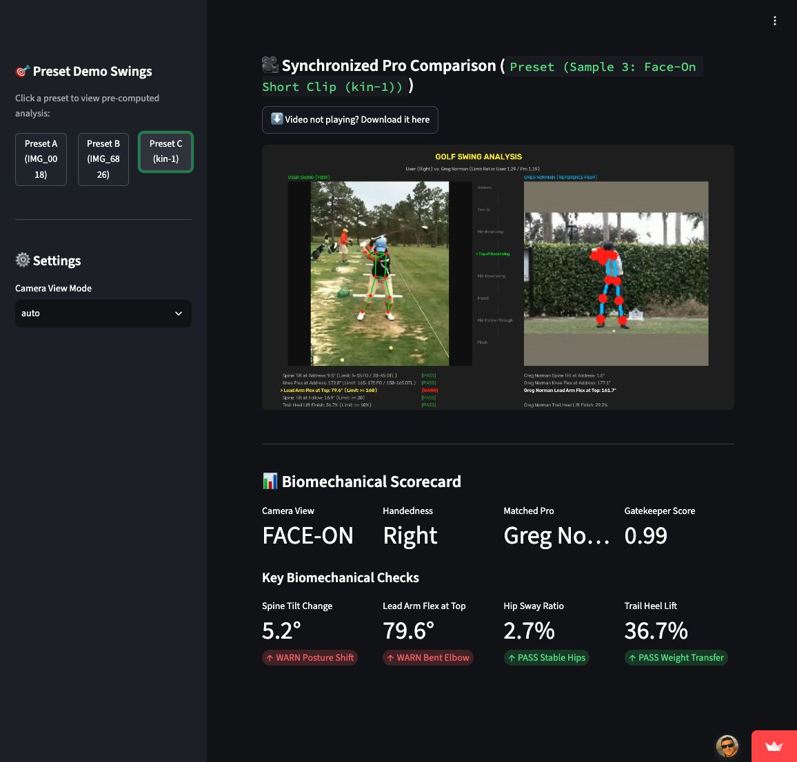
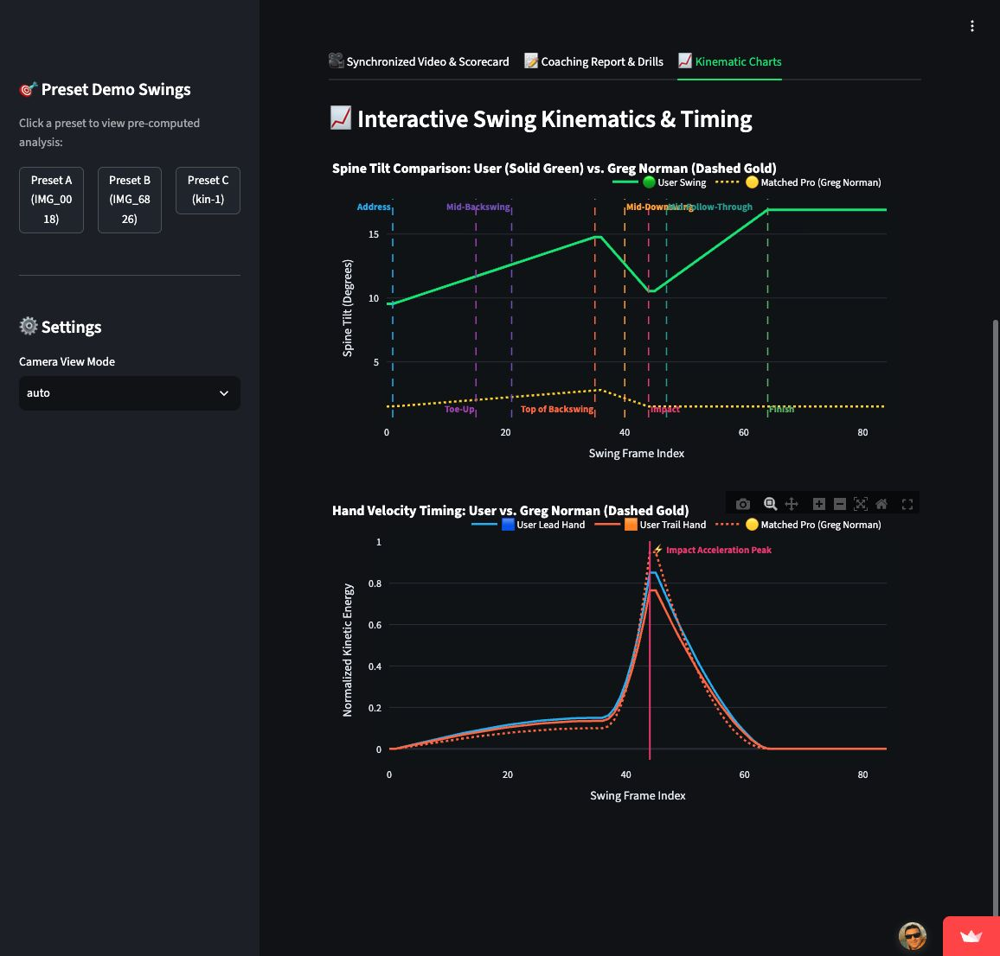

# Golf Swing Analysis Pipeline — Part 3: From Model to Application

*Working title*

> **Try the live demo:** [Open the Golf Swing Analyzer](https://golf-pro.streamlit.app/) and choose a preset swing to explore the results, or upload your own video.

A notebook can end with a metric. A usable video-analysis pipeline has to keep going.

After building the gatekeeper and milestone model, I wanted the output to be understandable without opening a dataframe. The application validates a phone video, identifies eight milestones, evaluates biomechanical measurements, matches a professional reference, and renders the swings side by side.

The individual steps are easy to describe. Making them behave as one reliable system was not.

*Precomputed results for the face-on `kin-1` demo preset, captured from the deployed application. The comparison video and scorecard make the model outputs visible; this screenshot is not a new upload evaluation.*

## Building the result around the user

The pipeline begins with inexpensive checks. Videos longer than one minute are rejected before pose extraction. MediaPipe produces body landmarks, which are smoothed and normalized before XGBoost filters non-golf footage. For accepted clips, the BiLSTM selects eight ordered milestones.

The next decisions depend on filming perspective. A face-on swing supports measurements such as lateral hip sway and vertical head movement. A down-the-line swing is better suited to forward spine posture. I built a hybrid camera-view heuristic using shoulder width and depth at Address. Back-testing it across 1,399 preprocessed clips produced 98.1% agreement with the dataset labels.

Once view and handedness are estimated, a rules engine calculates lead-arm flex, spine tilt, knee flex, hip sway, head stability, and heel movement. These are compared with explicit thresholds rather than passed through another opaque model.

The application searches 16 professional reference clips. Matching is intentionally simple: it selects the closest arm-to-torso ratio from the same view. The two timelines are warped between corresponding milestones, so the events align in the rendered video.

*The same precomputed preset also exposes spine-tilt and hand-motion traces alongside the matched professional reference. These charts help inspect the comparison; they do not establish coaching accuracy.*

> **Figure placeholder 2 — End-to-end pipeline.** Show: upload → validation → pose landmarks → eight milestones → view-specific measurements → professional match → synchronized dashboard and report.

## Accuracy was only one source of difficulty

Several failures appeared only after integration. Full-video gatekeeper averages could hide a short swing. A mismatch between class numbers and display names shifted physical heuristics to the wrong milestones. Pose processors also carried timestamp state between the user and professional clips, so the videos needed isolated processing contexts.

Deployment added another set of constraints. An inference method that worked in a notebook could stall inside the web application, browser playback required a consistent H.264 output format, and the cloud environment needed system libraries that were already present on the development machine. None of these changes improved the training metric, but each one determined whether a user received a result.

One useful performance improvement came from preprocessing the fixed professional library. Loading stored landmarks and milestone metadata instead of analyzing the matched professional on every request reduced one measured end-to-end run from 7.63 seconds to 4.06 seconds—a 46.8% reduction.

> **Figure placeholder 3 — Runtime before and after caching.** Use two bars labeled “Live pro processing: 7.63 s” and “Cached pro processing: 4.06 s.” Caption: “Preprocessing the fixed reference library removed repeated work from each request.”

## What the current results mean

The last recorded successful 10-video GolfDB regression run produced an overall milestone MAE of 2.41 frames. All seven manually collected user videos also passed the gatekeeper and generated dashboards. These are useful checks, but they are small and should not be read as proof that the application handles every golfer, camera, or environment.

The remaining limitations are visible. MediaPipe does not track the club or ball. Down-the-line handedness can still be misclassified when perspective reverses the apparent shoulder and hip geometry. The biomechanical thresholds are rules of thumb rather than clinically validated coaching advice, and the professional match is based primarily on one skeletal proportion.

That distinction matters. The application is a working demonstration of an end-to-end approach, not a replacement for a coach. Its value is that each stage can be inspected: the landmarks, milestone probabilities, selected frames, measured angles, comparison video, and evaluation metrics. Turning those parts into a usable pipeline required more work than training any single model—and produced a more honest test of whether the model was useful.

---

**Explore the project:** [GitHub repository](https://github.com/Ameenota/golf-analysis) · [Live Streamlit app](https://golf-pro.streamlit.app/)
