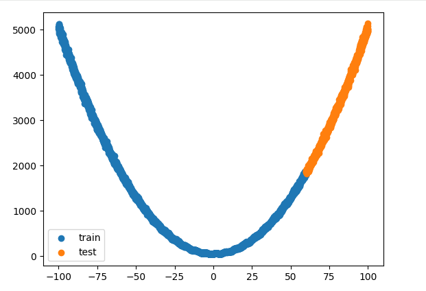
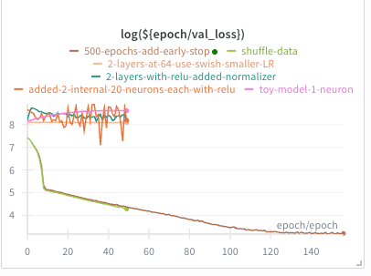
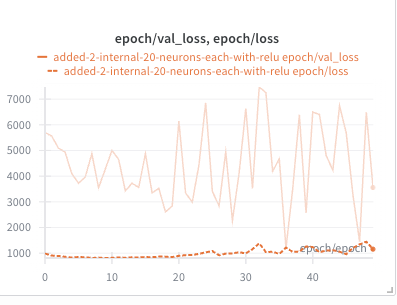
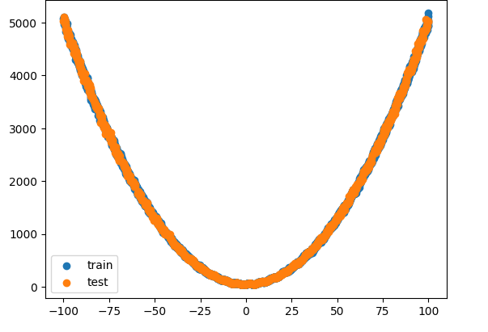
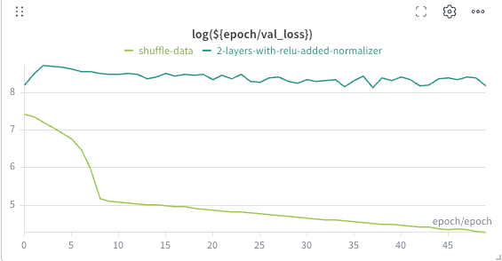

When you are 10 versions deep into building a model, it’s easy to forget which hyperparameters you last changed. Before tools like Weights & Biases (W&B), iterative development was the Wild West. We relied on messy spreadsheets, cryptic file names like `model_v3_final_FINAL_v2.h5`, and sticky notes to track experiments. It was tedious, error-prone, and nearly impossible to reproduce.

In this guide, I use a noisy synthetic dataset to demonstrate a systematic model-improvement workflow. Our NumPy-generated dataset has a single feature. The relationship is shown below. The more experienced among you will notice that the test data does not represent the training data and needs to be randomized—we’ll get to that later.



*Polynomial relationship between our feature and label.*

## W&B Setup

Enabling W&B tracking with TensorFlow (or most popular ML frameworks) is straightforward. First you create a (very generous) free account. Then you enable tracking before your model is setup.

```python
config = { # Put all hyperparameters in W&B for tracking
    "learning_rate": 0.01,
    "batch_size": 32,
    "epochs": 50,
    "dataset": "first-attempt",
}

wandb_run = wandb.init(
    project="wandb-demo",
    name="initial-attempt", # change this on every run!
    config=config
)

model = tf.keras.Sequential...

#make sure to call the logger during fit()
model.fit(X_train, Y_train,
          epochs=wandb_run.config.epochs, # get parameters from w&b
          batch_size = wandb_run.config.batch_size,
          validation_data=(X_test, Y_test),
          callbacks=[WandbMetricsLogger()] # make sure to log back to W&B
```

W&B gives us a single source of truth for hyperparameters and results. The `name` parameter differentiates runs on the dashboard, while `project` groups related runs together.



*log(validation_loss) vs EPOCH*

The graph above summarizes this article. In this log loss vs epoch plot, you can see that my initial attempts performed no better than just guessing a number. However, my final attempt brought the loss down from thousands to ~5. By visually inspecting our changes we can easily see if our changes are helping or hurting the model. The rest of this article focuses on the steps used to build and improve the model.

## Step 1: Baseline

The first model was a straightforward sequential network: `Input(shape=(1,))`, followed by two `Dense(20, activation='relu')` layers and a final `Dense(1)` output. I compiled it with MAE loss and an Adam optimizer at `lr=0.01`, training for 50 epochs. Crucially, I was not scaling or even shuffling the data.

The initial training step returned horrifying numbers: `loss: 280.8896`, but a staggering `val_loss: 3263.7993`. The `val_mse` was even worse at `11514056.0000`. This massive discrepancy between *training* and *validation* screams a fundamental problem. It means our model cannot generalize.

Viewing the metrics in W&B it was immediately clear that the val_loss and val_mse were erratic. This is a classic indication of a high learning rate.



*Step:1 Baseline graph of loss and val_loss*

The W&B chart above makes this easy to visualize. loss curve descends slowly but val_loss was orders of magnitude higher and erratic.

The validation loss was higher because we never shuffled before splitting out the test data: the “*exam*” asked questions that were not in the “*training*” syllabus.

## Step 2: Iterating in the right direction

Our first requirement is to shuffle the data before splitting it. Scikit-learn makes this easy with `train_test_split(X, y, test_size=0.2, shuffle=True, random_state=42)`. This guarantees that both the training and validation sets contain samples from across the polynomial curve and its associated noise.



*A much better distribution of training and test data*

Immediately, the **Charts** tab showed val_loss dropping significantly, now tracking much closer to loss. The "generalization gap" began to close, indicating the model could now see similar data patterns in both sets.

Next I added a normalization layer to the network. Neural networks perform best when inputs are centered around zero and have a consistent scale. Our original X from -100 to 100, and y values in the thousands, presented a challenge for the optimizer. Adding it within the network means that we do not have to process the data before using it in our model.



*The validation-loss impact of shuffling and normalization*

Once again, tracking these improvements with W&B shows us we are going in the right direction.

## Step 3: Fine-Tuning

As we now have a stable learning rate, we iteratively added the following improvements (and tested with W&B at each phase).

- **Lower learning rate (`lr=0.001`):** After normalization, a reduced learning rate allows the optimizer to make more precise adjustments.

- **Increased model capacity:** We increased the model to two `Dense(64)` layers, giving it more parameters to learn the polynomial and sine-wave components.

- **Early stopping:** To prevent overfitting, we used `tf.keras.callbacks.EarlyStopping(monitor='val_loss', patience=10, restore_best_weights=True)`. This stops training when validation loss has not improved for a specified number of epochs and restores the best weights.

- **Dropout regularization (`Dropout(0.2)`):** Since our dataset included noise, overfitting was a risk. Dropout randomly deactivates a percentage of neurons during training, reducing reliance on any one path through the network.

## Final numbers

After these changes, the final model’s [`val_loss`](https://colab.research.google.com/drive/1BlAHGYg6oF2N93O5z5vPaLxFG1Z63DnS?usp=sharing) fell from thousands to around **5–8**. The `val_mse` was now in the range of **30–100**. This was a dramatic improvement, indicating that the model had learned the underlying function while handling the injected noise.

W&B’s **Charts** confirmed the stability, with loss and val_loss converging closely, plateauing gracefully, and showing the precise epoch where EarlyStopping would have saved the best model.

W&B also provides a mechanism to save each model and track which one performed the best over all your iterations.

## Conclusion

W&B simplifies iterative development. While you could do everything it provides with a spreadsheet, it would be tedious, error prone and hard to share. W&B’s visualizations guided us into a systematic optimization workflow. We made informed decisions based on the live feedback from our experiments. While this was just a demo on synthetic data, large teams use tools like W&B similar to version control to iteratively build far more complex models and track performance history.
