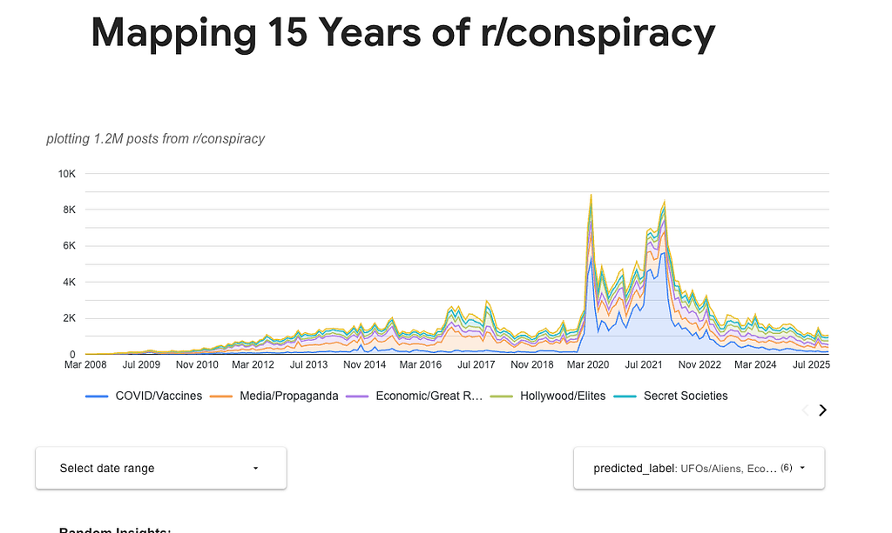
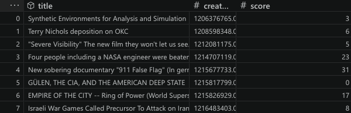

*TL;DR — You can explore the historical conspiracy data in [Looker Studio](https://lookerstudio.google.com/reporting/066578f9-4f08-49ec-99e1-869a43e055a1/page/tEnnC).*



*Categorized data from r/conspiracy*

To analyze how conspiracies evolve over time, I collected posts from the [r/conspiracy](https://www.reddit.com/r/conspiracy/) subreddit. To classify them, I used *knowledge distillation*: a capable but expensive teacher model creates labels that train a faster, cost-efficient student model. Using BigQuery ML, I trained the student to categorize the posts into topics such as the Deep State, COVID-19, UFOs, 9/11, and Epstein.

## Data processing

Reddit data dumps are available on [Academic Torrents](https://academictorrents.com/browse.php?search=reddit&c6=1). The raw conspiracy-post dataset contains about 1.5 million rows, or roughly 600 MB. While BigQuery would be a better fit for a production pipeline, I used pandas for the initial cleanup because it was familiar and fast for this scale.

For cleanup, I dropped empty or deleted posts and posts with zero engagement. This left 1.2 million dated posts.



## The teacher creates labels

The core problem was the lack of ground-truth labels. To create a large labeled sample without breaking the bank, I used Gemini 2.5 Flash to process 100,000 posts.

Instead of hitting standard API rate limits and managing manual backoffs, I used *Vertex AI Batch Predictions*. This allows you to send massive, non-latency-sensitive requests efficiently. Vertex prefers JSONL input, which I generated via Python using the following prompt:

```text
Prompt:
"Classify this conspiracy title into EXACTLY one category: "
"COVID/Vaccines, 9/11, JFK, Epstein, Israel, UFOs/Aliens, Flat Earth, Moon Landing, "
"Secret Societies, Dead Internet Theory, Generative AI/Slop, Climate/Weather Control, "
"Hollywood/Elites, Economic/Great Reset, Media/Propaganda, Deep State/Politics, Other. "
"GUIDELINES: "
"- 'Dead Internet Theory': Claims the web is already 99% bots or was 'turned off' around 2016. "
"- 'Generative AI/Slop': Claims about ChatGPT, Deepfakes, AI art, or LLMs replacing humans. "
"Return ONLY the EXACT category name from the list above. No intro, no explanation. "
"Title: "

Gemini Settings:
{
  "temperature": 0.0, # keep the responses consistent and not creative
  # Had to play with this a bit to land on this number.
  # Gemini does use up quite a few tokens thinking
  "maxOutputTokens": 500
}
```

Batch predictions are around half the cost of live API requests. It took around 2 hours and cost roughly $50. After filtering for occasional token-limit errors, I was left with a golden dataset of 96K rows.

## Training the student

With the training data ready, I switched to BQML, which lets you build managed models with SQL. The entire model definition is below:

```sql
CREATE OR REPLACE MODEL `conspiracy.label_predictor_v18_final`
TRANSFORM(
  -- (single words and two-word pairs)
  ML.NGRAMS(SPLIT(title, ' '), [1, 2]) AS title_features,
  label
)
OPTIONS(
  model_type='LOGISTIC_REG', -- use Logistic Regression for Classification
  input_label_cols=['label'],-- target label for training
  auto_class_weights=TRUE,

  -- add L2 regularization or else everything was classified into popular categories
  L2_REG = 0.2,
  MAX_ITERATIONS = 50,
  EARLY_STOP = TRUE,
  MIN_REL_PROGRESS = 0.001
) AS
SELECT title, label FROM `conspiracy-493120.conspiracy.final_labeled`
WHERE title IS NOT NULL AND label IS NOT NULL;
```

I opted for *logistic regression*. I also tried XGBoost, but it was harder to get the multiclass text model to converge. BigQuery handles the title features and train/test split, eliminating much of the boilerplate required in a lower-level TensorFlow or PyTorch pipeline. It also exposes evaluation metrics such as precision, recall, and F1.

Using `ML.NGRAMS([1, 2])`, the model evaluated nearly **800,000 unique features** made up of single words and two-word pairs. Bigrams preserve useful phrases: “White House,” for example, becomes a distinct feature rather than two unrelated words.

**L2 regularization** helped prevent the model from memorizing specific titles and pushed it toward more general patterns.

The final model achieved a **ROC AUC of 89.8%** across 17 categories, including *UFOs/Aliens*, *Media/Propaganda*, and *Secret Societies*.

## Inference

With the model evaluated, I ran inference across the full **1.2 million rows**. This appended a predicted label and confidence score to every retained post. The full prediction query took only a few minutes.

Once the labeled dataset was ready, I connected it to a [Looker Studio dashboard](https://datastudio.google.com/reporting/066578f9-4f08-49ec-99e1-869a43e055a1/page/tEnnC) for exploration.

## Insights

Gemini 2.5 took 2 hours and cost around $50 to label 100K examples. BQML’s total cost for training and inference was less than $2. This student model is also *much* faster than Gemini as it is trained for a very specific task rather than acting as a general-purpose LLM.

Performance is ultimately limited by label consistency. For example, if a title says, “Government is forcing us to get Vaccines,” should it be categorized as “Deep State” or “COVID/Vaccines”? Whatever the choice, the labeling must be consistent. Since most conspiracies involve the government, it was vital to split the data into more specific buckets.

## Conclusion

This started as a simple project to explore Vertex AI and Google Cloud, but it proved how accessible building production-grade ML systems has become. The entire pipeline only took around 6 hours of active work. By using the Teacher-Student paradigm, you get the best of both worlds: the high-level reasoning of an LLM for training and the speed and efficiency of a specialized BigQuery model for scale.
