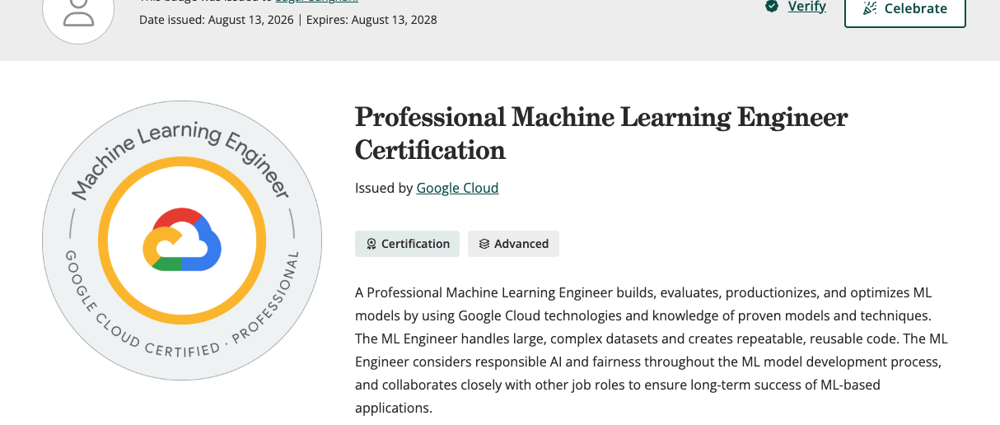

Last week I passed the Google Cloud Professional Machine Learning Engineer exam on my first attempt after preparing for about 30 hours over two months.

I already had experience with Google Cloud and ML. I decided to take the exam because I was working on AI/ML projects, and structured learning helps me understand concepts better.

Google updated the exam in June 2026 to reflect the transition from Vertex AI to Gemini Enterprise Agent Platform, changes to its data and analytics stack, and a preference for cloud-native solutions. The [exam page](https://cloud.google.com/learn/certification/machine-learning-engineer) has the current details.

It is a professional-level exam, and I found it hard. The questions test whether you can understand an ML problem, work through the business and technical constraints, and choose an appropriate solution.

Here is the kind of question you have to work through:

> A model was trained on data in BigQuery and is now serving predictions from an endpoint. Labels arrive 30 days later, but production traffic now includes far more customers from a cohort that was underrepresented in the training data. What should you do first?

This requires an understanding of data drift, BigQuery, endpoints, and model monitoring.

## Recommended study guide

- Do the hands-on work, such as the [Google Skills PMLE learning path](https://www.skills.google/paths/17) and its labs. I spent about half my time on these. The labs are practical and very relevant to the exam. You get 35 free credits each month, which I quickly ran out of, so I spent $29 to cover the remaining labs. The Google Skills path was the best money I spent.
- Another thing that helped was actually implementing things in GCP. Pipeline questions were giving me a lot of trouble, so I went in and built an end-to-end training, serving, and monitoring pipeline. This made all the pieces click much better.
- Read the docs when you get stuck, including BigQuery, model endpoints, Feature Store, Model Monitoring, and pipelines. Obviously, you don't need to read every page, but make sure to cover the introductions and understand the benefits and limitations of all the major services. Google Cloud services change extremely quickly, and the docs are the best way to get the latest information.

### Quizzes, quizzes, and more quizzes

I did way too many online quizzes. The score was not really the useful part. The useful part was figuring out why my answer was wrong and why another option fit the scenario better.

I couldn't find a question bank that worked the way I wanted, so I built my own: [Quiz Trail](https://quiz-trail.web.app/). It is free to use.

Quiz Trail has 407 public practice questions collected from GitHub repositories. I cleaned them up manually with help from AI. They are not questions from my exam, and Google Cloud services change quickly, so I would still treat the linked Google documentation as the source of truth.

The feature I really wanted was a simple **Copy AI prompt** button. It copies everything—the question and the answer choices—into a clean prompt so I can ask my favourite LLM to explain it. That is much nicer than copying each part by hand or working with screenshots when a provider blocks copy/paste. It also has the basics, such as breaking down your performance by exam section or difficulty.

## The resources I used

| Item                                                                                                                           | My recommendation                                                                   |
| ------------------------------------------------------------------------------------------------------------------------------ | ----------------------------------------------------------------------------------- |
| Official PMLE book                                                                                                             | Skip it for this version. It is too far behind the current platform and exam.       |
| [Google Skills PMLE path](https://www.skills.google/paths/17)                                                                  | Best money I spent. The practical labs were the most useful part of my preparation. |
| [Google Machine Learning guide](https://developers.google.com/machine-learning)                                                | Recommended, especially if you are new to ML.                                       |
| Skillcert                                                                                                                      | Skip it. The questions felt like flashcards instead of scenarios.                   |
| Whizlabs                                                                                                                       | Add it if you have time, but keep it low priority.                                  |
| [Official exam guide](https://cloud.google.com/learn/certification/guides/machine-learning-engineer) and product documentation | Highly recommended. Use these when other material conflicts.                        |
| [gcp-pmle-quiz](https://github.com/AndyTheFactory/gcp-pmle-quiz)                                                               | A huge free collection with a lot of good questions, although some are out of date. |
| [Quiz Trail](https://quiz-trail.web.app/)                                                                                      | Free, updated, and a shameless self-plug.                                           |

## What the exam was actually like

My exam had 50 questions, and every one had a single answer. Every question gave me a scenario with several constraints to work through. Google does not provide a score or tell you which areas you did well in. You just get a pass or fail.

My completely unscientific diagnosis is that I felt good about around 35 questions. Another 10 were hard, usually because there was a great second option. For about three, I had literally no idea what was going on :).

I took the exam in person at a Pearson testing center and had plenty of time to read every question carefully. The weird part was that the timer does not stop if you need a break. I did not take one and finished with about 10 minutes left.

## Odds and Ends

- I got zero questions that required reading code. Google also says the exam does not directly assess coding skill, although you should be able to understand Python or SQL snippets.
- I got zero direct TensorFlow questions. I only had one indirect question about using a preprocessing graph during serving.
- Picking the right hardware was especially hard for me. Make sure you understand when to use CPUs, GPUs, or TPUs, along with the different notebook and Workbench environments.
- Learn pipelines by actually building one. This was one of my weaker areas until I did the practical work.
- There were a number of agentic AI questions, but they were pretty straightforward. Make sure you understand the basics of agents, RAG, vector databases, and the newer generative AI services.

That is basically it. Do the practical labs, use quizzes to find the things you don't understand, and keep the official documentation open for review. The exam is a lot more about understanding why an answer fits the scenario than remembering a vague feature or config parameter.

Hope this helps someone, and good luck.
