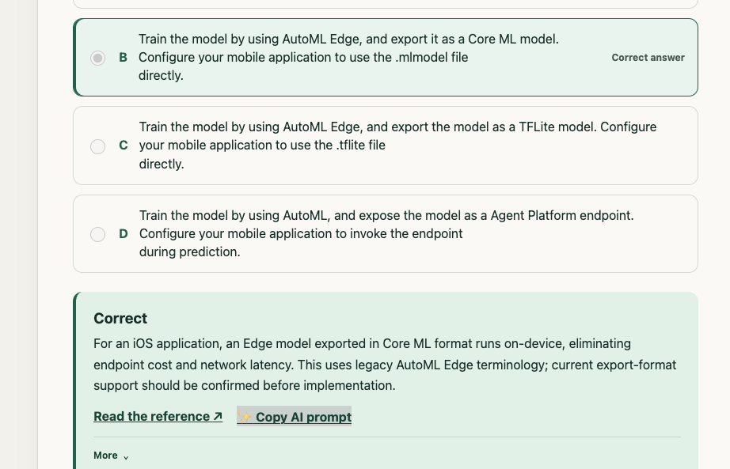

# How I passed the Google Cloud Professional Machine Learning Engineer (PMLE) Exam in 2 months

The GCP PMLE tests your knowledge on practical scenarios around solving data science and ML problems using Google Cloud services. While I did have experience building models, I find structured learning helps me understand concepts much better.

I passed the recently updated (June 2026) version of the exam. This is a professional level exam so considered **hard** by Google. It requires an understanding of ML concepts, parsing business use cases, and applying a solution (generally) using Google services

Check out this sample question:

> You recently developed a custom ML model that was trained in Agent Platform on a post-processed training dataset stored in BigQuery. You used a Cloud Run container to deploy the prediction service. The service performs feature lookup and preprocessing and sends a prediction request to a model endpoint.
>
> You want to configure a comprehensive monitoring solution for **training-serving skew** that requires **minimal maintenance**. What should you do?

> **A.** Create a Model Monitoring job using the BigQuery training data for training-serving skew detection, send email alerts, and diagnose the issue when an alert is received.

> **B.** Enable request-response logging, build a dashboard comparing training and serving data, and send a daily email report.

> **C.** Create a Model Monitoring job for skew, send alerts through Cloud Logging, and have a Cloud Run function automatically initiate retraining whenever an alert occurs.

> **D.** Build your own daily Dataflow + TensorFlow Data Validation solution and automatically retrain when skew is detected.

This requires knowledge of how training works, what drift is and multiple GCP services. The answer is A if you are curious.

### A practical approach to passing the PMLE :

1) Do the [Google Skills](https://www.skills.google/paths/17). This is the easiest and most affordable way to gain familiarity with the AI services such for training, serving, monitoring including building RAG pipelines and agents.
2) Read the documentation on the primary services such as BigQuery, Endpoints, Feature Store etc.
3) Do many many quizzes and understand why you are going wrong.

The challenge is that AI offerings change constantly so for example the [official book](https://www.oreilly.com/library/view/official-google-cloud/9781119944461/) as of this writing, is completely out of date. Focus on the practical aspects as that gives you the best chance of passing. I did way too many online quizzes and honestly did not find an up to date one for the new exam. So I just built my own at [https://quiz-trail.web.app/](https://quiz-trail.web.app/). This is availaible for free.

This contains a question bank updated manually with AI assist. The one feature I was missing from other engines was a simply 'copy everything in a nice prompt' so I can ask my favourite LLM about this question.

Summary of sources I used is

| Item               | Recommendation              | 
| ------------------ | --------------------------- | 
| Official PMLE Book | Skip, its out of date |  
| [Google Skills](https://www.skills.google/paths/17)  | Best money spent, highly recommended|   
| [ML Guide](https://developers.google.com/machine-learning) | Recommend, especially if you are new to ML |
| Skillcert | Skip the questions are not realistic |
| Whizlabs | Add this if you have time, but low priority|
| [Offical Docs](https://docs.cloud.google.com/gemini-enterprise-agent-platform) | Highly recommended
| [gcp-pmle-quiz](https://github.com/AndyTheFactory/gcp-pmle-quiz) | Huge free resource of questions, there are many good ones here but its a bit out of date|
| [Quiz-Trail](https://quiz-trail.web.app) | Free updated (and shameless self plug) |

### Whats happens in the exam :

The [official guide](https://cloud.google.com/learn/certification/machine-learning-engineer) contains the actual details of what is covered. In my experience, every question I got was single choice. Every question was a real scenario where you have to work through the constraints to get to the correct answer. There are a total 50 questions. Google does not give you details beyond just telling you if you passed. I'm pretty sure I got ~35 of them on the first try. ~10 were hard where I was mostly sure but a secondary answer looked good too, and for 3-4 I had literally no idea what was going on. 

I did the exam in person, and I found I had plenty of time to go through every question in detail. The one issue was the if you need a break, your timer doesnt stop but I was done with about 10 minutes to spare.

### Tips
* I got 0 questions that required reading code
* Again 0 question on Tensorflow (except one indirect on on attaching a preprocessing graph during serving)
* Some of the questions around picking the right hardware (GPU, TPU, Workbench env) were especially hard for me. 
* There were a number of Agentic AI questions but frankly they were pretty straightforward. Make sure you understand the basics of creating agents, RAG, Vector DBs etc. 

Hope that helps someone and good luck. 