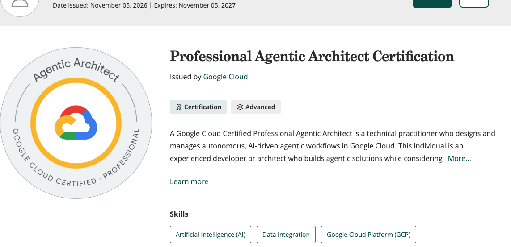
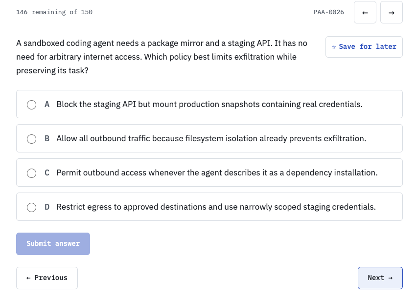

I’ve earned the Google Cloud Professional Agentic Architect certification. I spent about three weeks preparing for the written exam, but there is a fairly big asterisk next to that: I already had experience building agents on GCP and had passed the Professional Machine Learning Engineer exam.

That helped a lot. If you are new to cloud or agent development, I would not use those three weeks as a planning estimate. Google [recommends three or more years of hands-on cloud experience, including at least one year building agentic solutions on Google Cloud](https://cloud.google.com/learn/certification/agentic-architect). Allow time to build that experience as well as study for the exam.

I took the beta written exam on September 30, 2026. The certification also requires separate hands-on labs, which I have since completed. Check Google’s [certification page and FAQs](https://cloud.google.com/learn/certification/agentic-architect) for the current process, especially if you are taking it after the beta.

## How I prepared

A lot of my preparation for the written exam involved quizzes and working through the answers with AI. The loop was simple: answer a question, explain why I had picked that option, and work through the reasoning. Then I would try a different scenario testing the same idea.

Sometimes I knew the answer. Sometimes I recognized the product name. Sometimes three options were bad enough that the fourth one won by default. All three can look exactly the same on a results screen.

The explanations and follow-up scenarios were the useful part. A score alone could not tell me which of those three things had happened.

## Where my preparation lacked depth

The most useful thing I wrote down after the written exam was: “Honestly I think I was missing depth.”

I felt reasonably good about how it had gone. I also knew there were things I could discuss quite comfortably until someone asked me to choose the actual configuration. Then it got less comfortable.

Two-legged versus three-legged OAuth was one of mine. I had trouble with it, and OpenID Connect was another topic I was underprepared for. “Use OAuth” sounds like a reasonable answer until you have to explain whose authority the agent is using.

For external tools, Google documents [two-legged OAuth using client credentials](https://docs.cloud.google.com/iam/docs/auth-with-2lo-v2) for the agent’s own authority, and [three-legged OAuth](https://docs.cloud.google.com/iam/docs/auth-with-3lo-v2) for access on behalf of a specific user. The destination still has to enforce what that caller can access. I would spend more time configuring these flows if I were preparing again.

Evaluation was another area that needed several passes. At one point in practice I learned when a model-based evaluator was useful, then promptly tried to use one for something we could check directly: which tools were called, in what order, and with whose identity. A little knowledge, enthusiastically applied :).

Here is an invented practice example of another distinction I had to work through:

> An assistant retrieves last year’s policy and accurately repeats it. The policy has since changed. Can the answer be grounded and still give the user the wrong information?

Yes. The [groundedness check](https://docs.cloud.google.com/gemini-enterprise-agent-platform/reference/models/evaluation) compares the response with the context supplied to it. If that context is the old passage, the answer can be supported by it while still being wrong about the current policy. You also need to check correctness and whether retrieval selected the right version.

Agent Studio routes and internal settings also caught me out. My preparation had sometimes stopped at knowing what a service did. I needed to go further into using it.

## What I would do differently

If I were doing the preparation again, I would use quizzes to decide what to build next:

- For tool authentication, configure a small example and follow the identity through the request.
- For evaluation, run a few cases, deliberately break something, and see which check catches it.
- Spend more time setting up Agent Gateway. That was one of the things I specifically came away wishing I had practiced more.

For resources, start with the [official exam guide](https://services.google.com/fh/files/misc/professional_agentic_architect_exam_guide_english.pdf) and the [Google Skills learning path](https://www.skills.google/paths/4525). Use the product docs to go deeper where practice exposes a gap. Google describes the learning path as a starting point, and that matches my experience of needing more depth than broad topic coverage alone.

## Practicing with Quiz Trail

I had already built [Quiz Trail](https://quiz-trail.web.app/#quiz) for PMLE preparation. After the Agentic Architect written exam, I put together a separate bank of **150 original PAA practice questions**, with AI assistance, using my study notes, public exam objectives, documentation and the topics I needed to understand better.

Each question has an explanation and a documentation reference. The bank covers all five exam domains, with extra practice around areas such as evaluation, identity and retrieval. These are independent practice questions, not official Google questions or copies of questions from my exam.

Here is a sample of what to expect from the practice bank. A sandboxed coding agent needs a package mirror and a staging API, but no arbitrary internet access. The question is how to limit data leaving the environment while still letting the agent do its work.

**Correct answer: D. Restrict egress to approved destinations and use narrowly scoped staging credentials.**

Filesystem, network, and credential controls address different paths. Restricting outbound network traffic (egress) to the destinations the task needs, and limiting what its credentials authorize, provides defense in depth. Filesystem isolation alone does not stop network leaks, a model’s explanation is not a network policy, and snapshots containing real credentials introduce new risk.

The feature I still like most in Quiz Trail is the **Copy AI prompt** button. It copies the question and answer choices into a prompt for my preferred LLM. Small feature, but copying four options separately gets old quite quickly.

The follow-up I find useful is something like this:

> I chose this answer because of these constraints. Explain where my reasoning breaks down. Why is the next-best option weaker? Then give me a different scenario testing the same concept and wait for my answer.

I also want to revisit questions I guessed correctly, because the green tick is being a bit generous there.

AI makes this kind of back-and-forth easy. It also makes it easy to generate a convincing explanation for a weak question. We had to correct and retire some of our earlier practice items. I would keep the official docs open and challenge the answer when something does not add up, including on my own site.

As of November 5, **[ten PAA sample questions are public](https://quiz-trail.web.app/agentic-ai/sample-questions/)**. The full interactive PAA bank is in private preview and is marked coming soon. PMLE practice is already available. The public PAA samples let you see the questions and explanations without signing in.

Free, useful I hope, and yes, a shameless self-plug.

If you try the [PAA samples on Quiz Trail](https://quiz-trail.web.app/agentic-ai/sample-questions/), pick the alternative that almost convinced you and explain why it loses. I found those conversations much more useful than finishing another batch of questions.

Hope it helps, and good luck.
