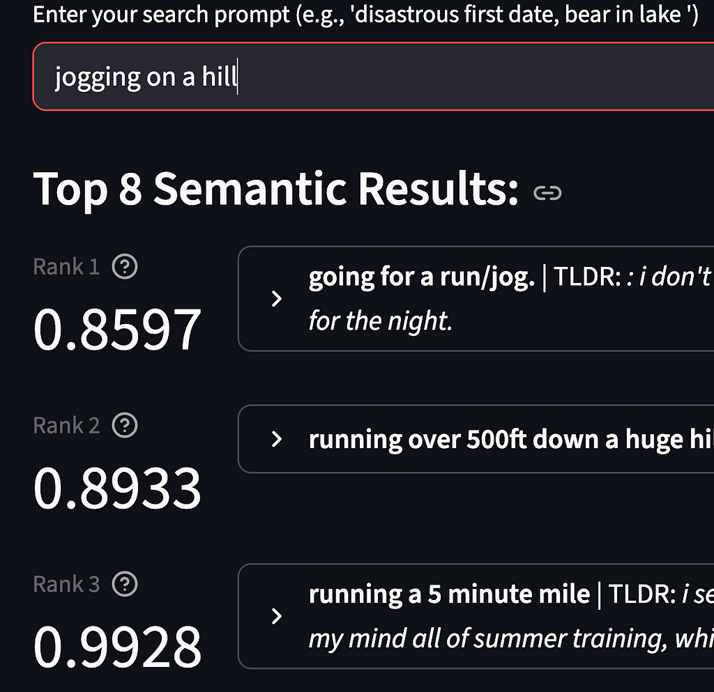
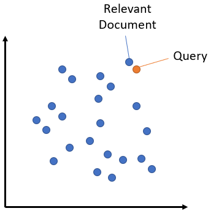
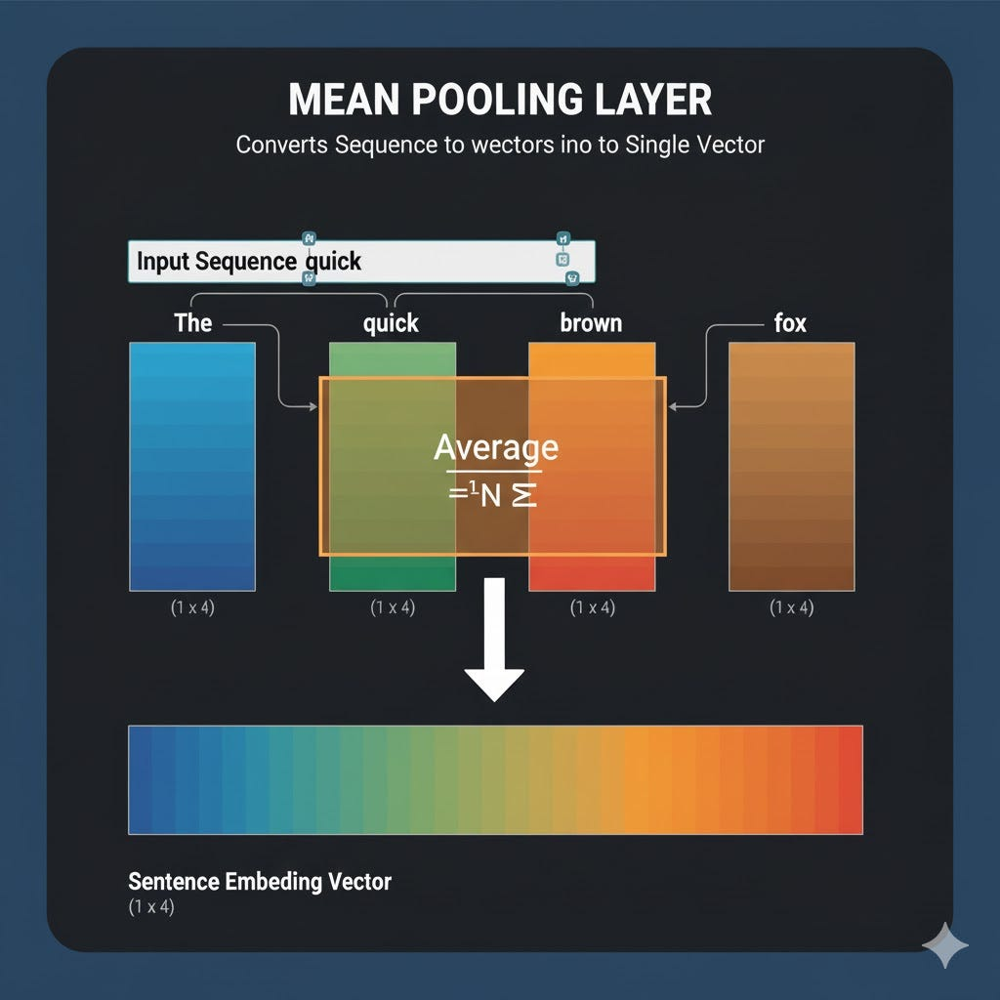
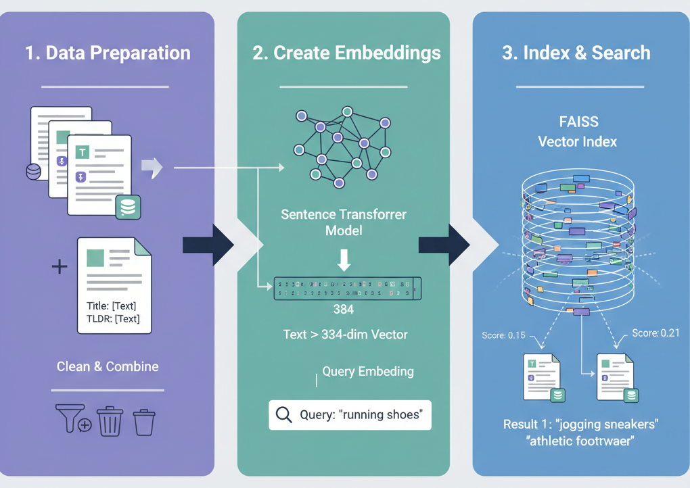

Semantic search tries to understand the meaning and context of a query rather than only matching keywords. For example, a traditional search for running shoes might return documents containing “*running*” and “*shoes*.” A semantic approach can also match related terms such as *sneakers*, *athletic footwear*, and *jogging shoes*, along with brands such as Nike or ASICS.

## Demo

To showcase semantic search, [the demo app](https://huggingface.co/spaces/sagsan/tifu-semantic-search) runs on around 20,000 entries from a [custom dataset](https://huggingface.co/datasets/sagsan/reddit_tifu_with_embeddings) built from [Reddit’s r/tifu](https://www.reddit.com/r/tifu/) subreddit. Try a few terms and see how they match against titles and TL;DRs.

Note: You may need to restart the demo as it turns off automatically when un-used.



*Demo Semantic Search App, with scores (lower is better)*

The rest of this post will give explain how this works.

## Understanding Embeddings

You may have heard about tokens in the context of LLMs. A token is a word or, more often, part of a word that is mapped to a numeric ID. A sentence transformer converts a sequence of tokens into a vector—a list of numbers—that represents the sentence. One common way to form that vector is mean pooling, which combines the token representations. Once text is represented this way, we can search for nearby vectors with similar meaning.



*Finding “similar” documents based on a query (credit: SBert)*

A model, such as the transformer in an LLM, **operates entirely on numbers**. It cannot directly process letters, words, or sentences. Tokenization breaks text into units called tokens and maps each token to an integer ID. An embedding model then represents the text as a **vector of numbers** that can be compared mathematically.

When a sentence is tokenized, it becomes a sequence of individual token vectors. However this is not very useful for search. **Mean pooling** solves this by taking the numerical vector representation for *every single token* in the sentence and calculating the **average** of all those vectors presenting a single vector that captures the meaning of your input sentence.



*Mean pooling tokens into a single vector (AI generated)*

In ML terms, an embedding is a vector has been **learned** by a machine learning model to represent the **meaning or semantic properties** of a complex object. The picture above represents embeddings in a 2-D space, but in the real world this have very high dimensions. In our case our embeddings have 384 dimensions.

To summarize, building a semantic search requires the following steps:



*Building a Semantic Search Pipeline (AI generated)*

1. Download, Cleanup and prepare your data

2. Encode your documents to create vector embeddings.

3. Encode your query and use an index to find documents “*close*” to it.

## Approach

As with all things in modern AI, there are many approaches that simplify how to do this. There is really no need to build a model, implement mean pooling or even exactly know how Neural Networks work to build all of this. We will use the following tools to build this:

1. *HuggingFace:* HF can be thought of as the GitHub for MachineLearning. It provides a centralized repository to share models, datasets and even demo applications. Our demo runs on HF and we will a model and dataset deployed there.

2. [*SBert Sentence Transformers:*](https://www.sbert.net/docs/sentence_transformer/pretrained_models.html#multi-qa-models)* *SBert provides pretrained models via the HuggingFace API. These have been trained on millions of documents and greatly simplify our logic. We will directly download a model from here and use it to build our embeddings.

3. *Facebook AI Similarity Search:* FAISS a library that creates an index enabling fast search on our embeddings. FAISS is an industry standard for efficient search and is used for billion parameter searches.

## Data Prep

HuggingFace already has a [dataset with r/tifu ](https://huggingface.co/datasets/dany0407/reddit_tifu_long)posts, downloading this is easy with the HF datasets library:

```python
from datasets import load_dataset
dataset = load_dataset("dany0407/reddit_tifu_long", split="train")
dataset = dataset.select(range(20000))
dataset
Dataset({
    features: ['ups', 'num_comments', 'upvote_ratio', 'score', 'documents', 'tldr', 'title'],
    num_rows: 20000
})
```

The features represent available columns for each post, what we want to do is build a composite feature combining ‘title’ and ‘tldr’ fields. Our vector embeddings will be built on these columns. We also drop the columns we don’t need:

```python
# create a new field called text
def combine_content(row):
  return {"text": "Title: " + row["title"] + "\n\nTLDR: " + row["tldr"]}

# map iterates over our data and calls the combine_content method for each row
dataset = dataset.map(combine_content)
dataset = dataset.remove_columns(['ups', 'num_comments', 'upvote_ratio', 'score'])
```

At this point our dataset looks as follows. It has 20K rows and columns for document (body) of the post, title, tldr and our composite ‘text’ field.

```text
Dataset({
    features: ['documents', 'tldr', 'title', 'text'],
    num_rows: 20000
})
```

## Building Embeddings

We use the `all-MiniLM-L6-v2` model because it is small and works well for this example. In **asymmetric semantic search**, you usually have a short query and want to find a longer passage that answers it. There are [larger models designed specifically for this task](https://sbert.net/docs/pretrained-models/msmarco-v5.html).

```python
from sentence_transformers import SentenceTransformer
# 1. Download the model
model = SentenceTransformer('all-MiniLM-L6-v2')

# 2. Map the model to create an 'embeddings' column by encoding the 'text' field
def embed_text(batch):
    return {'embeddings': model.encode(batch['text'], convert_to_numpy=True)}

dataset_with_embeddings = dataset.map(embed_text, batched=True, batch_size=32)
```

There’s a lot happening in the snippet above, the dataset.map function calls embed_text in batches of size 32. The function encodes our composite text column and creates a new column called *‘embeddings’.*

As an example, lets encode a single sentence and see what we get back.

```python
model.encode("The squirrel looked both ways before dashing across the road, then paused in the middle to question all its life choices.").shape
(384,)
```

The model encodes our sentence into an embedding vector of length 384. We now have a column containing one 384-dimensional vector for each entry in the dataset.

## Index & Search

FAISS lets us build a vector index over the dataset. Without an index, we would need to scan every entry for every query, which becomes slow at scale.

The Datasets library makes it easy to add a FAISS index to an embedding column:

```python
dataset_with_embeddings.add_faiss_index(column="embeddings")
```

**And that’s it.**

All our setup is done, now we can search our dataset with the following snippet

```python
scores, examples = dataset_with_embeddings.get_nearest_examples(
    index_name='embeddings',  # The name of the column you built the index on
    query=model.encode("sang with my boss"), # your input query
    k=2 # Number of results (or neighbors) you want returned
)

# Print the results
for tldr, title, body, score in zip(examples['tldr'], examples['title'], examples['documents'], scores):
    print(f"Score: {score}")
    print(f"Item: {title}\n")
    print(f"tldr: {tldr}\n")
    print(f"item: {body}\n")
```

This is pretty much the exact snippet that runs on the demo: [https://huggingface.co/spaces/sagsan/tifu-semantic-search](https://huggingface.co/spaces/sagsan/tifu-semantic-search)
