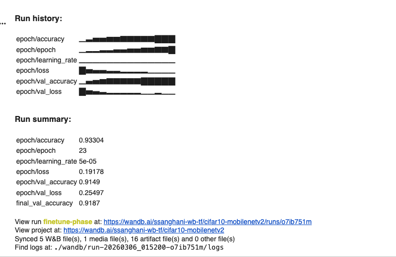
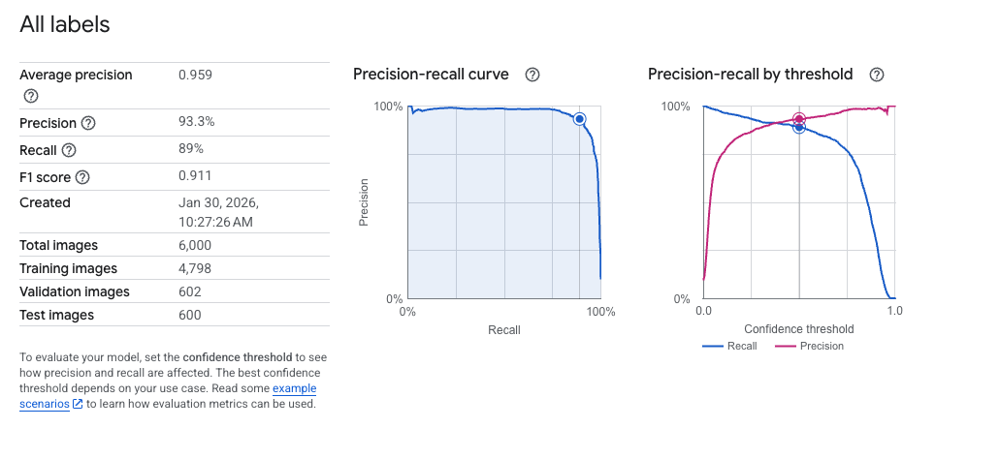
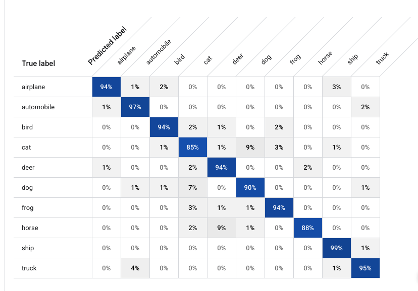

I spent two weekends—roughly four days—adapting MobileNetV2 to classify CIFAR-10 images. Then I gave the same job to Vertex AI AutoML for about $5.

This is the second part of the experiment. [Transfer Learning I explains how I built and fine-tuned the MobileNetV2 classifier]().

Both models produced a **91.1% F1 score** on the same 600-image evaluation set.

My custom model had lower log loss and slightly higher recall. AutoML had higher precision. Those differences were not large enough to change the practical result: AutoML reached the same overall quality without requiring me to build and tune a training pipeline.

For a technical lead, that is the useful comparison. A custom model should have to earn the extra engineering work.

## Four days versus about $5

| Dimension | Custom MobileNetV2 | Vertex AI AutoML |
|---|---:|---:|
| Hands-on effort | Two weekends, roughly four days | Not recorded; most of the work was data preparation |
| Direct cost | Not measured; trained locally | Approximately $5 |
| Hardest part | Fine-tuning and validation | Preparing and importing the data |
| F1 score | 91.1% | 91.1% |
| Log loss *(lower is better)* | **0.2433** | 0.3610 |
| Precision | ~91.1% | **93.3%** |
| Recall | **91.1%** | 89.0% |

These figures describe this evaluation, not a general cost or performance benchmark. The $5 is the approximate training cost for this run; it excludes data preparation time and deployment costs. AutoML setup time and local compute cost were not measured.

The custom model had lower log loss and higher recall, while AutoML had higher precision. I would still call the overall result a draw. F1 was identical, and the small metric differences did not justify four days of custom work for this use case.

## What I built by hand

CIFAR-10 contains 60,000 low-resolution images across ten categories, including airplanes, cars, cats, dogs, and ships. I used **transfer learning**, which adapts a model that has already learned useful visual patterns instead of training a network from scratch.

My base was MobileNetV2, a compact image model designed to balance accuracy and efficiency. I replaced its original classifier with a ten-class output layer and trained it in two phases. First I froze the pretrained model and trained only the new output layer, reaching roughly 82% validation accuracy. I then unfroze some of the later layers and fine-tuned them with a small learning rate.

The run summary lists epoch 23, training accuracy of 93.3%, and a final validation accuracy of 91.87%. The final shared evaluation produced the 91.1% F1 score used in the comparison.

This was a useful way to learn how transfer learning behaves. It was also four days of architecture decisions, checkpoints, fine-tuning, and validation work.

## What AutoML changed

With Vertex AI AutoML, I supplied the labeled images and started a managed training job. I did not have to choose which layers to freeze, select a fine-tuning boundary, or manage the training infrastructure. The run cost approximately $5.

The difficult part was getting the data into the service correctly. Managed training did not eliminate the work; it moved the work away from model design and toward data preparation.

I hit three avoidable problems:

- **Region configuration:** The job failed when my resources were split across locations. It worked after I placed the model, images, and results bucket in `us-central1`.
- **A ghost folder:** A zero-byte object named like a folder sat beside the images. The preprocessing job worked after I removed it and left a flat list of image files.
- **One broken filename:** A manifest entry ended in `.pn` instead of `.png`. That typo cost more time than it deserved.

Once the data was in the right shape and place, AutoML did the part I had spent two weekends doing.

## Good enough is a serious engineering result

The confusion matrix shows where AutoML struggled. Cats were classified correctly 85% of the time and were most often mistaken for dogs. Horses had a similar problem with deer. Ships, automobiles, and trucks were much easier.

There was still room to improve the model. That was not the decision I needed to make. The decision was whether a small improvement was worth owning a custom pipeline.

A custom model can make sense when the system needs on-device inference, strict latency, a specialized architecture, unusual inputs, or a measurable quality advantage on a business-critical metric. None of those constraints applied here.

For a conventional classification problem, AutoML gave me a credible model for about $5. It also gave me a baseline that any future custom model would have to beat by enough to matter.

## Start with AutoML

Building the MobileNetV2 pipeline taught me more. AutoML delivered the result faster.

Those are different objectives. If the goal is to learn the mechanics, build the model. If the goal is to deliver a working capability, start with the managed option and make custom development justify itself.

You probably do not need to build your own model. At least, not yet.
